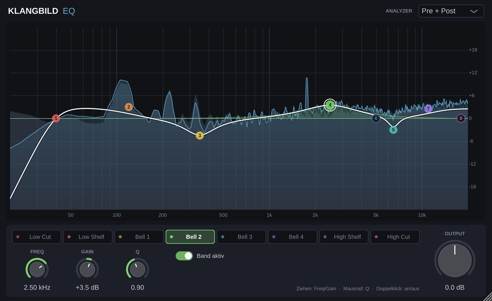

# Klangbild EQ

Parametrischer 8-Band-Equalizer mit Echtzeit-Analyzer – als **Audio Unit für Logic Pro**
(außerdem VST3 und eigenständige App). Gebaut mit [JUCE](https://juce.com).



## Funktionen

- **8 Bänder:** Low Cut, Low Shelf, 4× Bell, High Shelf, High Cut
- **Low/High Cut** mit 12, 24, 36 oder 48 dB/Okt. (Butterworth, Q-Regler für Resonanz)
- **Analyzer** (FFT, 4096 Punkte, 75 % Überlappung): *Pre* (grau, Signal vor dem EQ),
  *Post* (blau, nach dem EQ) oder beides; 3 dB/Okt. Neigung, damit Musik ungefähr flach aussieht
- **Ziehbare Punkte** direkt in der Kurve, Infobox mit Werten
- Weiche Parameteränderungen (keine Knackser beim Drehen), volle Automation in Logic
- Keine Latenz, Mono und Stereo, Fenster frei skalierbar

### Bedienung

| Aktion | Wirkung |
|---|---|
| Punkt ziehen | Frequenz (waagerecht) und Gain (senkrecht) |
| Mausrad über Punkt | Güte (Q) |
| Doppelklick auf Punkt | Band an/aus |
| Ausgeschalteten Punkt ziehen | schaltet das Band automatisch ein |
| Doppelklick auf Regler | Standardwert |

## Fertiges Plugin per GitHub bauen lassen (ohne Xcode)

1. Neues Repository auf GitHub anlegen und den Inhalt dieses Ordners hochladen
   (JUCE wird beim Bauen automatisch geladen).
2. Im Repository auf **Actions** gehen → der Workflow *macOS Build* läuft nach jedem Push
   (oder per *Run workflow* manuell). Dauer ca. 10–15 Minuten.
3. Wenn er grün ist: unten bei **Artifacts** `Klangbild-EQ-macOS` herunterladen
   und entpacken. Darin liegt `Klangbild-EQ-AU.zip`.

## Installation in Logic Pro

1. `Klangbild-EQ-AU.zip` entpacken → `Klangbild EQ.component`
2. Im Finder **Gehe zu → Gehe zum Ordner …** (⇧⌘G) und eingeben:
   `~/Library/Audio/Plug-Ins/Components` – die Datei dort hineinkopieren.
3. Da das Plugin nicht bei Apple notarisiert ist, einmal im Terminal ausführen:
   ```
   xattr -dr com.apple.quarantine ~/Library/Audio/Plug-Ins/Components/"Klangbild EQ.component"
   ```
4. Logic Pro starten. Falls es nicht auftaucht: **Logic Pro → Einstellungen → Plug-in-Manager**,
   *Klangbild* suchen und *Zurücksetzen & erneut scannen*.
5. Im Kanalzug unter **Audio Units → Klangbild → Klangbild EQ**.

## Selbst bauen (mit Xcode)

```bash
cmake -B build -G Xcode -DCMAKE_OSX_ARCHITECTURES="arm64;x86_64"
cmake --build build --config Release
```
Die Ergebnisse liegen in `build/KlangbildEQ_artefacts/Release/` (AU, VST3, Standalone).

## Projektaufbau

| Datei | Inhalt |
|---|---|
| `Source/EQDsp.h` | Filterformeln (RBJ-Cookbook), Butterworth-Kaskaden, Frequenzgang |
| `Source/PluginProcessor.*` | Parameter, Audioverarbeitung, Analyzer-Puffer |
| `Source/PluginEditor.*` | Oberfläche: Analyzer, Kurve, Regler |
| `.github/workflows/build-macos.yml` | Automatischer Mac-Build inkl. `auval`-Test |

## Lizenz-Hinweis

JUCE steht unter AGPLv3 bzw. einer kommerziellen Lizenz. Für den privaten Gebrauch ist das
unproblematisch; wer das Plugin verkaufen oder ohne Quellcode weitergeben möchte, braucht eine JUCE-Lizenz.
